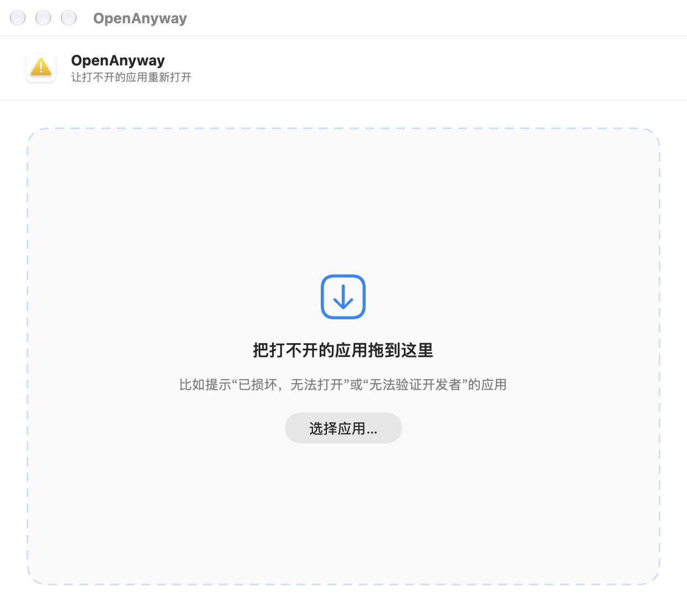
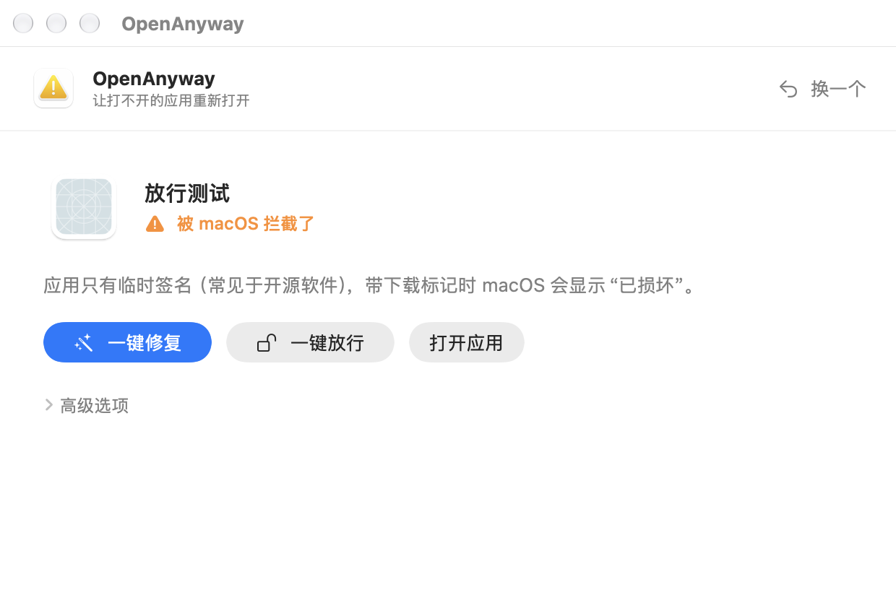

<div align="center">


# OpenAnyway

**Fix “App is damaged and can’t be opened” on macOS — in one click.**

English | [简体中文](README.zh-CN.md)

[](https://github.com/Atonettt/OpenAnyway/releases/latest)
[](https://github.com/Atonettt/OpenAnyway/releases)


### [⬇️ Download OpenAnyway](https://github.com/Atonettt/OpenAnyway/releases/latest/download/OpenAnyway.zip)

</div>

<p align="center">
  
  &nbsp;
  
</p>

---

macOS often refuses to open apps downloaded from the internet with messages like:

> “XXX” is damaged and can’t be opened. You should move it to the Trash.
>
> “XXX” can’t be opened because Apple cannot check it for malicious software.

The usual fix is a handful of Terminal commands copied from a forum. **OpenAnyway** does it for you: drag the app in, it figures out *why* macOS blocks it, and fixes exactly that.

## Features

- **Finds the real cause** — download quarantine flags, broken or missing code signature, unnotarized apps, apps running from a read-only DMG, unsupported CPU architecture, macOS version too old.
- **One-click fix** — removes quarantine flags from every file inside the app, re-signs it locally when needed, copies it out of a read-only DMG, and asks for your password only when required.
- **One-click “Open Anyway”** — for apps macOS still blocks, OpenAnyway opens *System Settings → Privacy & Security*, finds the **Open Anyway** button for that app and clicks it. You only confirm with Touch ID or your password.
- **Safe by default** — only touches the one app you choose, backs up before re-signing, never disables Gatekeeper or SIP, never clicks “Move to Trash”.
- **Works with more than apps** — DMG and PKG installers, plug-ins (VST3, AU, …) and command-line tools.
- Native SwiftUI app, ~1 MB download, runs fully offline. Universal binary for Apple Silicon and Intel.

> The app’s interface is currently in Simplified Chinese.

## Installation

1. [Download `OpenAnyway.zip`](https://github.com/Atonettt/OpenAnyway/releases/latest/download/OpenAnyway.zip) and unzip it.
2. Move **OpenAnyway.app** to your **Applications** folder.
3. **First launch:** OpenAnyway itself is not notarized by Apple, so macOS will block it the same way. Allow it once using either method:
   - Double-click it, click **Cancel**, then go to **System Settings → Privacy & Security** and click **Open Anyway**; or
   - run this in Terminal:
     ```bash
     xattr -dr com.apple.quarantine /Applications/OpenAnyway.app
     ```

**Requirements:** macOS 13 Ventura or later.

## Usage

1. Open OpenAnyway and **drag in the app** that won’t open (or click **选择应用…** to pick it).
2. Read the one-line result, then click **一键修复 (Fix)**.
3. If macOS still blocks the app, click **一键放行 (Open Anyway)**.
   The first time, macOS asks you to allow OpenAnyway under **Privacy & Security → Accessibility** — this lets it click the button in System Settings for you.
4. Confirm with Touch ID or your password. The app opens.

Advanced options (individual fixes, backup, raw check output, manual steps) are folded under **高级选项**.

## What it fixes

| Situation | What OpenAnyway does |
|---|---|
| Signed app, just not notarized | Removes the quarantine flag |
| Unsigned / ad-hoc signed app (common for open-source apps) | Removes the quarantine flag + re-signs locally |
| App inside a mounted DMG | Copies it to `/Applications` first |
| Developer signature broken | Recommends re-downloading; re-sign + Open Anyway available as a last resort |
| DMG / PKG / plug-in / CLI tool blocked | Removes the quarantine flag |
| Corrupted DMG, wrong CPU architecture, macOS too old | No fix offered — tells you what to do instead |

## FAQ

<details>
<summary><b>Is this safe?</b></summary>

OpenAnyway does exactly what the popular Terminal commands do (`xattr`, `codesign`), but only on the app you choose and only after showing you what it will run. It never runs `spctl --master-disable`, never turns off Gatekeeper or SIP, and never touches system security databases. Removing the quarantine flag means macOS will no longer warn you about that app — only do this for software from a source you trust.
</details>

<details>
<summary><b>Why does OpenAnyway need Accessibility permission?</b></summary>

Only for **一键放行 (Open Anyway)**: it needs to click the “Open Anyway” button in System Settings. It checks that the button belongs to the app you selected, never clicks “Move to Trash”, and never sees or types your password. Everything else works without this permission.
</details>

<details>
<summary><b>macOS keeps asking for Accessibility permission again after an update.</b></summary>

OpenAnyway is signed locally (ad-hoc), so macOS treats each new version as a different app. In **System Settings → Privacy & Security → Accessibility**, remove OpenAnyway with “−”, add it again with “+”, and turn it on.
</details>

<details>
<summary><b>The app opens, but some features don’t work.</b></summary>

If an app originally signed by its developer had to be re-signed, special permissions Apple granted to that developer (virtualization, system extensions, iCloud, …) are lost. Download a fresh copy from the official website and install it directly from the DMG — don’t extract it with third-party archivers or sync it through cloud drives, which can break the signature.
</details>

## Build from source

Requires Xcode 15 or later.

```bash
git clone https://github.com/Atonettt/OpenAnyway.git
cd OpenAnyway
xcodebuild -project MacAppDoctor.xcodeproj -scheme MacAppDoctor \
  -configuration Release -derivedDataPath ./DerivedData build
open DerivedData/Build/Products/Release/OpenAnyway.app
```

Or open `MacAppDoctor.xcodeproj` in Xcode and press ⌘R.

Run the core tests:

```bash
swiftc MacAppDoctor/Core/*.swift Tests/CoreSmokeTests.swift -o /tmp/openanyway-tests && /tmp/openanyway-tests
```

<details>
<summary>Project structure</summary>

```text
MacAppDoctor/
  Core/                       Logic, no UI (unit-tested)
    FileInspector.swift       Read-only checks: signature, quarantine, Gatekeeper, architecture…
    DiagnosisEngine.swift     Works out the cause and recommended fixes
    RepairService.swift       Runs the fixes, admin fallback, backup, re-check
    ExtendedAttributes.swift  Quarantine / extended-attribute access
    CommandRunner.swift       Runs system tools without a shell
  UI/
    MainView.swift            The single main window
    OpenAnywayAutomator.swift Clicks “Open Anyway” via the Accessibility API
    OpenAnywayGuide.swift     Manual Open Anyway steps
Tests/CoreSmokeTests.swift    Core tests
generate_project.py           Regenerates the Xcode project
```
</details>
