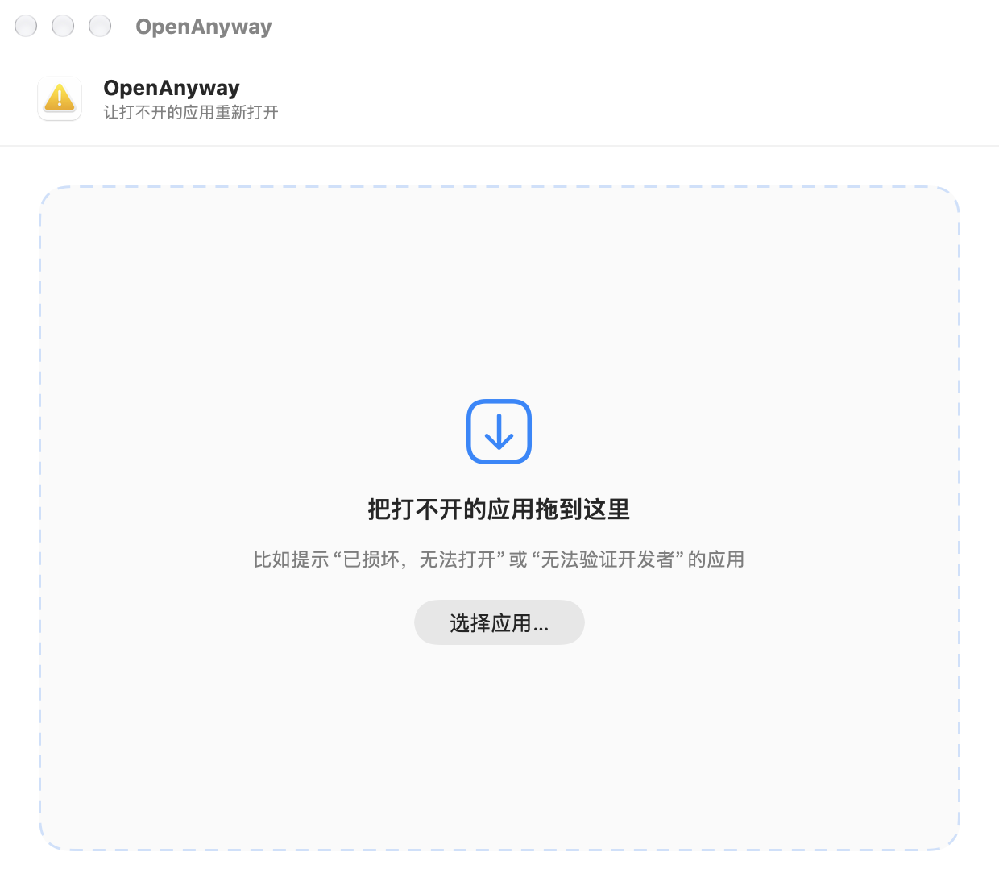
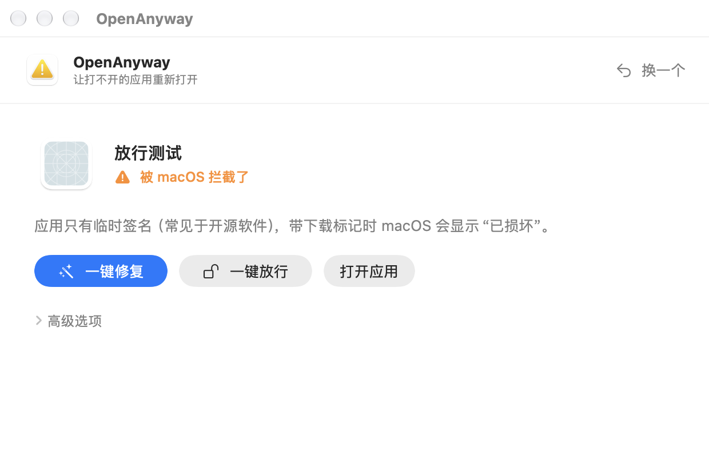

<div align="center">


# OpenAnyway

**一键解决 macOS “已损坏，无法打开”**

[English](README.md) | 简体中文

[](https://github.com/Atonettt/OpenAnyway/releases/latest)
[](https://github.com/Atonettt/OpenAnyway/releases)


### [⬇️ 下载 OpenAnyway](https://github.com/Atonettt/OpenAnyway/releases/latest/download/OpenAnyway.zip)

</div>

<p align="center">
  
  &nbsp;
  
</p>

---

从网上下载的软件，macOS 经常拒绝打开：

> “XXX”已损坏，无法打开。你应该将它移到废纸篓。
>
> 无法打开“XXX”，因为 Apple 无法检查其是否包含恶意软件。

网上的做法通常是复制几条终端命令。**OpenAnyway** 帮你做完这些：把应用拖进来，它会找出 macOS 拦截的**真正原因**，再针对性地修复。

## 功能

- **找出真正原因**：下载隔离标记、签名损坏或缺失、未经公证、在只读 DMG 里直接运行、处理器架构不兼容、系统版本过低。
- **一键修复**：清除应用内所有文件的隔离标记、必要时本地重新签名、把应用从只读 DMG 复制出来；只有需要时才请你输入密码。
- **一键放行（仍要打开）**：对 macOS 仍然拦截的应用，自动打开“系统设置 → 隐私与安全性”，找到这个应用对应的 **仍要打开** 按钮并点击，你只需用触控 ID 或密码确认。
- **默认安全**：只修改你选中的那一个应用，重签名前自动备份，不会关闭 Gatekeeper 或 SIP，永远不会点“移到废纸篓”。
- **不只是应用**：DMG、PKG 安装包、插件（VST3、AU 等）、命令行工具也能处理。
- **中英文界面**：自动跟随系统语言。
- 原生 SwiftUI 应用，下载仅约 1 MB，完全离线运行，同时支持 Apple 芯片和 Intel。

## 安装

1. [下载 `OpenAnyway.zip`](https://github.com/Atonettt/OpenAnyway/releases/latest/download/OpenAnyway.zip) 并解压。
2. 把 **OpenAnyway.app** 拖进 **应用程序** 文件夹。
3. **第一次打开：** OpenAnyway 本身没有经过 Apple 公证，所以 macOS 也会拦截它。用下面任一方法放行一次即可：
   - 双击打开，弹窗点 **取消**，然后到 **系统设置 → 隐私与安全性** 点 **仍要打开**；或者
   - 在终端运行：
     ```bash
     xattr -dr com.apple.quarantine /Applications/OpenAnyway.app
     ```

**系统要求：** macOS 13 Ventura 或更高版本。

## 使用方法

1. 打开 OpenAnyway，把打不开的应用**拖进窗口**（或点 **选择应用…**）。
2. 看一眼结果，点 **一键修复**。
3. 如果 macOS 仍然拦截，点 **一键放行**。
   第一次使用时，系统会请你在 **隐私与安全性 → 辅助功能** 中允许 OpenAnyway，这样它才能帮你点系统设置里的按钮。
4. 用触控 ID 或密码确认，应用就会打开。

具体修复项、备份、详细检查结果和手动放行步骤都收在 **高级选项** 里。

## 能解决哪些情况

| 情况 | OpenAnyway 的处理 |
|---|---|
| 有签名，只是没经过公证 | 清除隔离标记 |
| 未签名 / 临时签名（开源软件常见） | 清除隔离标记 + 本地重新签名 |
| 应用在已挂载的 DMG 里 | 先复制到“应用程序”文件夹 |
| 开发者签名已损坏 | 建议重新下载；也可重签名 + 一键放行 |
| DMG / PKG / 插件 / 命令行工具被拦截 | 清除隔离标记 |
| DMG 损坏、处理器架构不兼容、系统版本过低 | 不提供修复，告诉你该怎么做 |

## 常见问题

<details>
<summary><b>安全吗？</b></summary>

OpenAnyway 做的事情和网上流传的终端命令（`xattr`、`codesign`）一样，但只针对你选中的应用，并且执行前会告诉你要做什么。它不会运行 `spctl --master-disable`，不会关闭 Gatekeeper 或 SIP，也不会改动系统安全数据库。清除隔离标记后 macOS 不会再对这个应用发出警告，请只对来源可信的软件这样做。
</details>

<details>
<summary><b>为什么需要“辅助功能”权限？</b></summary>

只有 **一键放行** 需要：它要帮你点击系统设置里的“仍要打开”按钮。点击前会确认按钮属于你选中的应用，永远不会点“移到废纸篓”，也看不到、不会输入你的密码。其他功能都不需要这个权限。
</details>

<details>
<summary><b>更新后又提示需要“辅助功能”权限？</b></summary>

OpenAnyway 使用本地签名，macOS 会把每个新版本当成不同的应用。在 **系统设置 → 隐私与安全性 → 辅助功能** 里，用“−”删掉 OpenAnyway，再用“+”重新添加并打开开关即可。
</details>

<details>
<summary><b>应用能打开了，但部分功能不能用？</b></summary>

原本由厂商正式签名的应用如果被重新签名，Apple 授予厂商的特殊权限（虚拟化、系统扩展、iCloud 等）会失效。请从官网重新下载，直接从 DMG 安装；不要用第三方解压工具解压，也不要经过网盘或 iCloud 云盘同步，这些都可能破坏签名。
</details>

## 从源码构建

需要 Xcode 15 或更高版本。

```bash
git clone https://github.com/Atonettt/OpenAnyway.git
cd OpenAnyway
xcodebuild -project OpenAnyway.xcodeproj -scheme OpenAnyway \
  -configuration Release -derivedDataPath ./DerivedData build
open DerivedData/Build/Products/Release/OpenAnyway.app
```

也可以用 Xcode 打开 `OpenAnyway.xcodeproj`，按 ⌘R 运行。

运行核心测试：

```bash
swiftc OpenAnyway/Core/*.swift Tests/CoreSmokeTests.swift -o /tmp/openanyway-tests && /tmp/openanyway-tests
```

<details>
<summary>项目结构</summary>

```text
OpenAnyway/
  Core/                       核心逻辑，不含界面（有单元测试）
    FileInspector.swift       只读检查：签名、隔离标记、Gatekeeper、架构等
    DiagnosisEngine.swift     判断原因并给出推荐修复
    RepairService.swift       执行修复、管理员权限、备份、复查
    ExtendedAttributes.swift  读写隔离标记等扩展属性
    Localization.swift        中英文文本
    CommandRunner.swift       不经过 shell 调用系统工具
  UI/
    MainView.swift            唯一的主窗口
    OpenAnywayAutomator.swift 通过辅助功能自动点击“仍要打开”
    OpenAnywayGuide.swift     手动放行步骤
Tests/CoreSmokeTests.swift    核心测试
generate_project.py           重新生成 Xcode 工程
```
</details>
